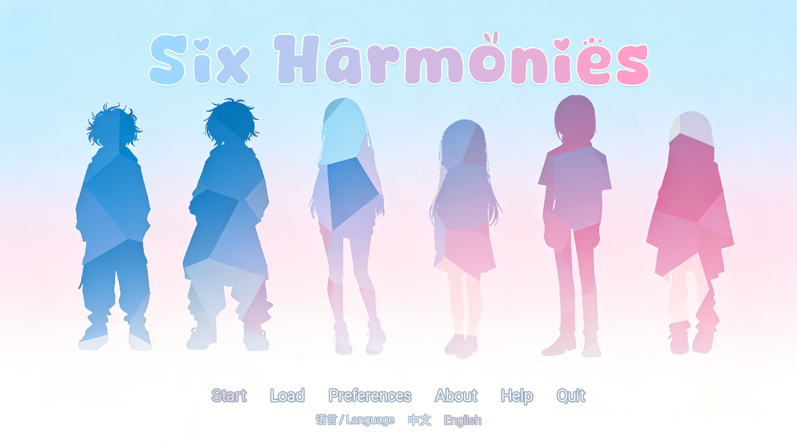
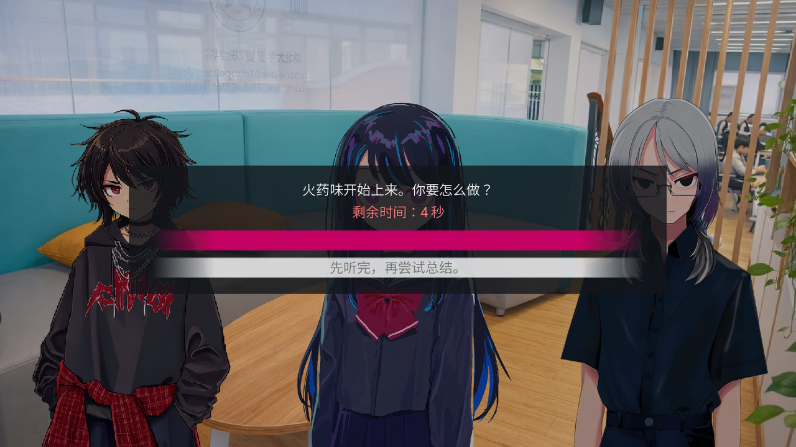
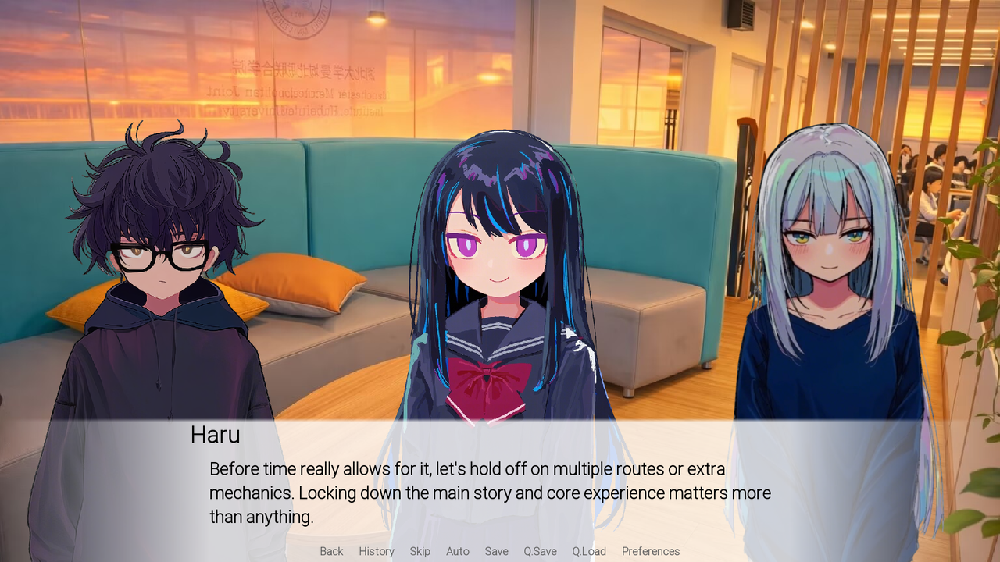
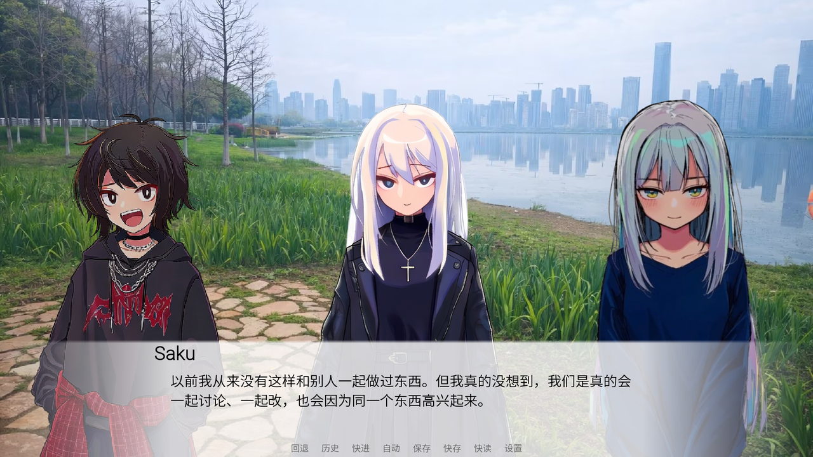

<div align="center">

# 六合奏 · Six Harmonies

**A Bilingual (中文 / English) Branching Narrative Visual Novel Built with Ren'Py 8**

[](https://www.renpy.org/)
[](#engineering-highlights)
[](#bilingual-localization-pipeline)
[](#getting-started)
[](LICENSE)

<br/>



<p>
  <em>Six teammates with clashing personalities. One two-week deadline to ship a playable game.<br/>Every decision—and every moment of hesitation—shapes whether six voices become a harmony or fall apart.</em>
</p>

[Overview](#overview) · [Screenshots](#screenshots) · [Architecture](#architecture) · [Engineering Highlights](#engineering-highlights) · [Getting Started](#getting-started)

</div>

---

## Overview

**Six Harmonies (六合奏)** is a self-contained, bilingual interactive visual novel (~38,700 Chinese characters / 1,999 dialogue blocks across a prologue and four chapters) about creative collaboration under pressure.

Stepping into the role of **Haru**, the reluctant leader of *Group Seven*, players navigate scope creep, creative friction, mid-project spot checks, and late-night crunch alongside five distinct teammates:

| Character | Role in Group Seven | Personality & Tension |
|---|---|---|
| **Haru** | Team Leader & Coordinator | Observant mediator balancing creative vision against hard deadlines |
| **Taku** | Concept & Ideation | High-energy brainstormer prone to scope creep and impulsive detours |
| **Rei** | Lead Programmer | Pragmatic, blunt engineer focused on clean architecture and runnable builds |
| **Hina** | Scenario Writer | Thoughtful storyteller protective of emotional pacing and narrative depth |
| **Saku** | Character Artist & UI Designer | Reserved perfectionist who communicates through visual craft rather than words |
| **Suzu** | Producer, QA & Scheduling | Disciplined planner who quietly absorbs the team's operational burden |

---

## Screenshots

<table>
  <tr>
    <td width="50%" align="center">
      
      <br/>
      <sub><b>Timed Decision System</b> — Real-time countdown modal where hesitation triggers its own narrative consequence</sub>
    </td>
    <td width="50%" align="center">
      
      <br/>
      <sub><b>Full English Localization</b> — Runtime language switching & five-slot brightness-focused staging</sub>
    </td>
  </tr>
  <tr>
    <td width="50%" align="center">
      
      <br/>
      <sub><b>Ensemble Character Staging</b> — Dynamic ATL transforms, speaker spotlighting, and custom quick-menu UI</sub>
    </td>
    <td width="50%" align="center">
      
      <br/>
      <sub><b>Custom Title Screen</b> — Per-character programmatic RGB gradient typography & instant language toggle</sub>
    </td>
  </tr>
</table>

---

## Architecture

The codebase separates narrative script logic, UI presentation, localization filtering, and media assets into four clean layers:

| Layer | Responsibility | Key Files |
|---|---|---|
| **State & Narrative** | Entry point, cohesion state machine, chapter sequencing, branching & ending evaluation | `game/script.rpy`, `game/prologue.rpy`, `game/chapter1.rpy`–`chapter4.rpy` |
| **Presentation & Staging** | Custom screens, countdown choice modal, programmatic title styling, 5-slot ATL staging & mobile variants | `game/screens.rpy`, `game/characters.rpy`, `game/gui.rpy` |
| **Localization (i18n)** | First-launch language modal, persistent preference storage, runtime text/display filter hooks & string tables | `game/i18n.rpy`, `game/tl/english/*.rpy` |
| **Configuration & Assets** | Desktop/Android build rules, sprites, backgrounds, BGM channels & typography | `game/options.rpy`, `android.json`, `game/images/`, `game/bgm/` |

### Branching State Machine & Endings

Player decisions across Chapters 2, 3, and 4 accumulate into a persistent `team_cohesion_score` variable rather than relying on a single last-minute binary flag:

```text
[Prologue] ──► [Chapter 1] ──► [Chapter 2] ──► [Chapter 3] ──► [Chapter 4]
                                    │               │               │
                             Timed Choice     Conflict Modal   Final Scope
                             (±1 Cohesion)    (±1 Cohesion)   (±1 Cohesion)
                                    └───────────────┼───────────────┘
                                                    ▼
                                      Evaluate team_cohesion_score
                           ┌────────────────────────┼────────────────────────┐
                           ▼                        ▼                        ▼
                     Score ≥ 2                0 ≤ Score < 2              Score < 0
                 ┌───────────────┐          ┌───────────────┐        ┌───────────────┐
                 │  Good Ending  │          │ Normal Ending │        │  Bad Ending   │
                 │  和声成章      │          │  并肩过关      │        │  六人挂科      │
                 └───────────────┘          └───────────────┘        └───────────────┘
```

---

## Engineering Highlights

### 1. Reusable Countdown Choice Modal (`timed_choice`)
Implemented in [`game/screens.rpy`](game/screens.rpy), `screen timed_choice(items, prompt="", timeout=6.0, timeout_value="timeout")` provides a modal decision overlay with a deterministic 1-second tick counter. Reaching `0s` automatically resolves to `timeout_value`, turning player indecision into a first-class narrative branch during heated team arguments.

### 2. Runtime Bilingual Localization Pipeline
Implemented in [`game/i18n.rpy`](game/i18n.rpy) and [`game/tl/english/`](game/tl/english/):
- **Zero-restart switching:** Hooks into `config.say_menu_text_filter` and `config.replace_text` alongside Ren'Py's `Language()` action so players can toggle between **简体中文** and **English** at any moment from either the title bar or Preferences menu.
- **First-launch onboarding:** Uses `label before_main_menu` and `persistent.language_pref` to prompt new players once and persist their choice across sessions.

### 3. Five-Slot Ensemble Staging & Focus System
With six protagonists frequently sharing the screen, [`game/characters.rpy`](game/characters.rpy) defines five named stage coordinates (`left2`, `left1`, `center`, `right1`, `right2`), directional ATL entrance transitions (`chara_enter_left`, `chara_enter_right`, `chara_enter_fade`), and `BrightnessMatrix` lighting transforms (`dimmed` vs. `normal_light`) to keep visual focus on the active speaker without clutter.

### 4. Programmatic Typography & Responsive Mobile Layout
- `main_menu_title_text()` in [`game/screens.rpy`](game/screens.rpy) computes per-glyph RGB interpolation (`#9fd8ff` → `#ff9fc8`) at init/render time while preserving whitespace alignment.
- Dedicated `screen_variant("small")` style overrides and `game/gui/phone/` assets adapt typography sizes, dialogue bounds, and quick-menu controls for Android touchscreens.

---

## Project Structure

```text
six-harmonies/
├── game/
│   ├── script.rpy          # Entry point, global cohesion state, chapter end-card helper
│   ├── prologue.rpy        # Prologue: An Incomplete Prelude
│   ├── chapter1.rpy        # Chapter 1: When the Wind Blew Across the Blank Page
│   ├── chapter2.rpy        # Chapter 2: After-School Draft Paper (incl. timed choice)
│   ├── chapter3.rpy        # Chapter 3: After the Calm (incl. conflict timed choice)
│   ├── chapter4.rpy        # Chapter 4: Finale & multi-ending evaluation
│   ├── characters.rpy      # Character objects, sprite mappings, 5-slot ATL transforms
│   ├── screens.rpy         # Custom title screen, dialogue UI, timed_choice modal
│   ├── i18n.rpy            # Bilingual preference state & runtime translation filters
│   ├── gui.rpy             # 1920x1080 base resolution & responsive phone overrides
│   ├── options.rpy         # Metadata, audio mixers, save directory & archive rules
│   ├── tl/english/         # Complete English dialogue, display & UI string translations
│   ├── images/             # 19 campus/city backgrounds & 60+ character expression sprites
│   ├── bgm/                # 17 atmospheric background music tracks
│   ├── fonts/              # Custom display typography
│   └── gui/                # Desktop & mobile (phone/) UI textures
├── docs/images/            # Gameplay & UI preview screenshots
├── android.json            # Android packaging & orientation configuration
├── project.json            # Ren'Py SDK project configuration
└── LICENSE                 # Mulan Permissive Software License v2
```

---

## Getting Started

### Prerequisites
- [Ren'Py SDK 8.x](https://www.renpy.org/latest.html) (tested with **Ren'Py 8.5**)

### Run Locally
1. Clone this repository into your Ren'Py projects directory:
   ```bash
   git clone https://github.com/cuiocuio/six-harmonies.git
   ```
2. Open the **Ren'Py Launcher**, refresh the projects list, select **Six Harmonies**, and click **Launch Project**.

### Verify Script Integrity (Headless Lint)
```bash
renpy.sh /path/to/six-harmonies lint
# Windows PowerShell:
& "C:\path\to\renpy-8.x-sdk\lib\py3-windows-x86_64\python.exe" "C:\path\to\renpy-8.x-sdk\renpy.py" .\six-harmonies lint
```

### Build Distributions
- **Desktop (Windows / macOS / Linux):** Open Ren'Py Launcher → *Build Distributions* → Select *PC: Windows and Linux* or *Mac Macintosh*.
- **Android:** Open Ren'Py Launcher → *Android* → Generate local signing keys (`android.keystore` / `bundle.keystore` are git-ignored by design) and build APK/AAB.

---

## License

Source code is licensed under the [Mulan Permissive Software License, Version 2 (Mulan PSL v2)](LICENSE).  
Third-party fonts and audio tracks remain the property of their respective authors and license terms.
